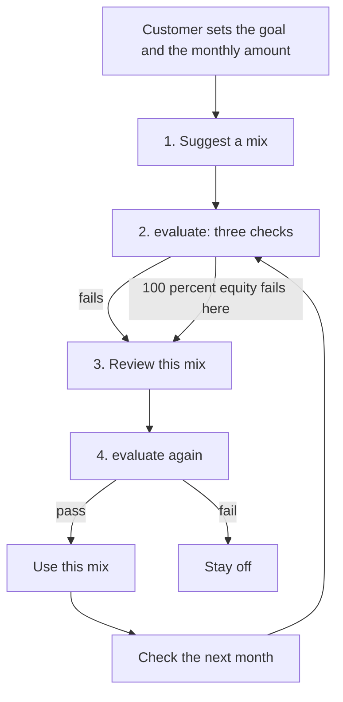
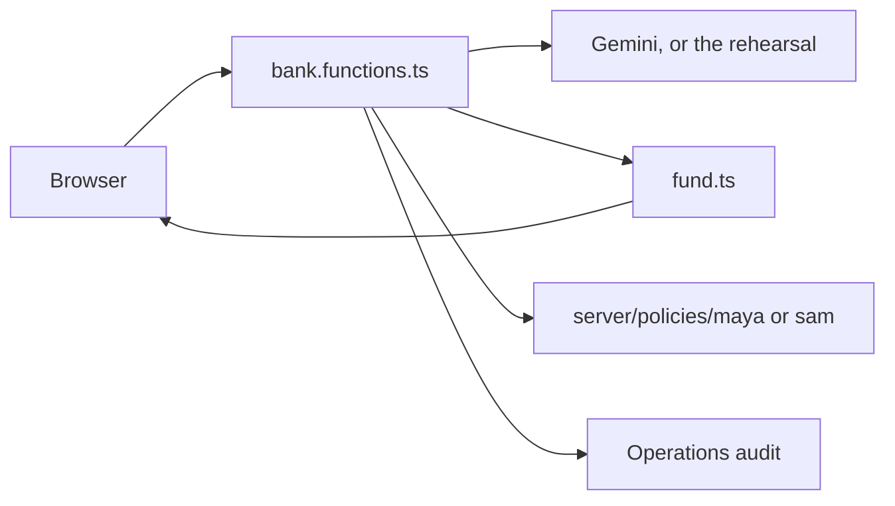

# Mango Bank — Fund Advisor

A small retail bank you can run on your laptop. Two customers, Maya and Sam, each set a savings goal. A model may suggest how to split that monthly amount across cash, bonds, and equity. The bank turns the split on only if ordinary code says it passed.

The model does not move money. It does not change how much the customer adds each month. It does not see the exam markets, and it does not grade its own answer.

## Run it

```bash
npm start
```

Then open:

| Who | Address | Sign in |
|---|---|---|
| Maya | http://localhost:8080 | `maya` / `mango` |
| Sam | http://localhost:8080 | `sam` / `mango` |
| Operations | http://localhost:8080/admin | `ops` / `mango` |

The model key lives only on the server, in [config/gemini.server.json](config/gemini.server.json):

```json
{ "apiKey": "your-key" }
```

You can also set `GEMINI_API_KEY`. The browser never receives the key.

Leave the key empty, or let the call fail, and the app uses the rehearsal splits in `ruleFor()`. The checks still run. The operations audit says the model was not called.

## What the customer does

1. Sign in and look at the account. Nothing is invested.
2. Add a goal: a name, a target, a number of months, and a monthly amount.
3. Open Fund Advisor from the notice.
4. **Suggest a mix.** The model proposes cash, bond, and equity.
5. Read the three checks and the graph.
6. **Review this mix.** A second call rewrites the first one. It did not write the first one.
7. **Use this mix** only if the checks passed. Later months use those numbers. This click does not call the model.
8. **Check the next month.** On stage this is a button. In a real bank it would be a monthly job. The first click jumps six months. The mix already on stays unless the new suggestion passes the same checks.

Sam is the same screen with his own goal. His prompt is not built from Maya’s goal. A session shows up in operations only after that customer adds a goal or opens Fund Advisor.

## The screen

The left side is the decision. The right side is a picture of it.

- The sentence under the title is the goal she typed. The monthly amount is hers.
- **Suggest a mix** and **Improve this mix** call the model. The graph, the three checks, and **Use this mix** do not.
- The three number boxes are the suggestion. Change a number and the checks run again, still with no model call.
- **Rising** is the only market the first call may study. **Falling** and **Rate shock** are the exam.
- The horizontal line on the graph is her target.
- The dashed line knows the future. Each month it puts everything into whichever of cash, bond, or equity already went up. It is a ceiling, not a mix you can turn on.
- The red line is half cash and half equity, every month. No model. A suggestion has to finish closer to the dashed line than this red line, on the two markets it was not shown.
- The safety limit is separate: the three shares add to 100 percent, and equity stays at or under 70 percent.

The pass mark is not “the balance reached the target.” Deposits alone may be too small. Studio gear is $500 a month for 12 months, which is $6,000 toward $8,000. These tables never turn $6,000 into $8,000, even with perfect hindsight. After **Check the next month**, a card (plain arithmetic, not the model) says how much more she would need to add. She accepts it or she leaves her amount.

## Four steps

There is no agent framework, no LangGraph, and no decision graph. The order is four server calls. The yes or no is one function, `evaluate()`.



| Step | Button | Who decides | Model? |
|---|---|---|---|
| 1 | Suggest a mix | Model proposes three numbers | Yes |
| 2 | The three checks | `evaluate()` | No |
| 3 | Review this mix | A second call rewrites the first | Yes |
| 4 | Same three checks, then Use this mix | `evaluate()`, then the account stores the numbers | No |

**Check the next month** repeats that loop. **Improve this mix** is the review step for the later suggestion. **Switch to this mix** replaces the live numbers only when the new one beats the one already on.

## Where the work lives



| File | What it is |
|---|---|
| [src/lib/fund.ts](src/lib/fund.ts) | Markets, the graph, the three checks, the prompts, the rehearsal numbers |
| [src/lib/bank.functions.ts](src/lib/bank.functions.ts) | The buttons, the model call, and the audit |
| [src/components/fund-workbench.tsx](src/components/fund-workbench.tsx) | The Fund Advisor screen |
| [src/components/account-app.tsx](src/components/account-app.tsx) | Account, goals, payments |
| [src/components/admin-app.tsx](src/components/admin-app.tsx) | Sessions, health, prompt and reply |
| [config/gemini.server.json](config/gemini.server.json) | The key |

## Markets

`market()` in [src/lib/fund.ts](src/lib/fund.ts) builds one row per month. Each row is a return for cash, bond, and equity. Nothing is downloaded.

| Market | What the table does | Shown to the model? |
|---|---|---|
| Rising | Equity about +1.8% every month | The first four equity numbers only |
| Falling | Equity about −6% in the middle of the year | No |
| Rate shock | Bonds and equity fall together for a stretch | No |

`REALIZED`, just under that function, is the six months already passed when you press **Check the next month**.

`runPath()` is the graph. Start at zero. Each month, add her deposit, apply that month’s three returns with the split, and compound. Same inputs, same line.

## What the model actually sees

`authorPrompt()` pastes the goal and those four Rising numbers, and says not to receive Falling or Rate shock. Code writes that prompt. There is no trend model in front of it.

`judgePrompt()` does not get the tables. It is told an exam exists, and it is given the first suggestion to rewrite.

`askGemini()` in [src/lib/bank.functions.ts](src/lib/bank.functions.ts) is the only place the key is used. `ruleFromReply()` reads `cash`, `bond`, and `equity` out of the reply. Those three numbers are what Maya sees. If the reply has no numbers, she sees `ruleFor()`:

- First suggestion: 100% equity. The safety check fails.
- After review: 15% cash, 20% bond, 65% equity in a normal month, and 30 / 40 / 30 after a drop.

The `.py` file under `server/policies/<customer>/` is a record of the split. The graph and the checks run the same weights in TypeScript. The customer does not see the file or the prompt.

## The three checks

All of them are in `evaluate()`.

1. **Is this mix allowed?** Shares add to 100%, and equity is at or under 70%. A pretty line cannot override this.
2. **Did it use only your goal?** The server records the path: this customer, Rising only on the first call, the monthly amount unchanged, no other customer in the prompt.
3. **Is it better on markets it has not seen?** `runPath()` on Falling and Rate shock. The ending has to be closer to the dashed line than half-and-half. On a later month it also has to beat the mix already on.

Rising is ignored for the pass. The model is not asked whether it passed.

## Operations

http://localhost:8080/admin shows one row per customer who has used Fund Advisor.

- The runtime tile stays up when the model is down, because a mix that is already on does not call it.
- The key is never printed. The tile only says whether a key was found.
- The audit stores the prompt and the raw reply for each model step. That text is not sent back to the customer page.
